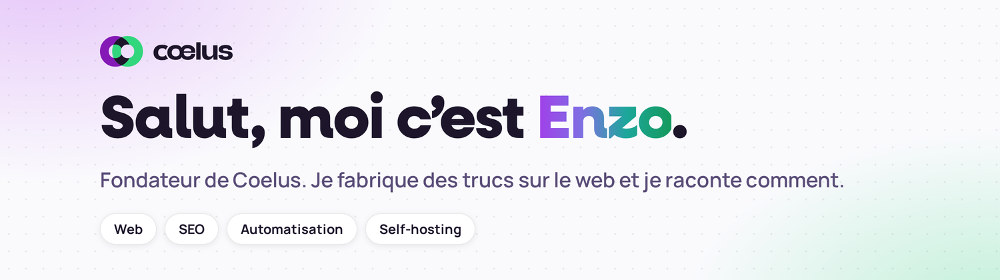

<picture>
  <source media="(prefers-color-scheme: dark)" srcset="assets/banner-dark.png">
  
</picture>

  
  
  
  
  

## 👋 Un peu de moi

Je suis Enzo, fondateur de **Coelus**. Je fabrique des sites, je fais monter des pages dans Google, j’automatise ce qui peut l’être et j’héberge moi-même tout ce que je peux. Ce que j’aime, c’est comprendre comment un outil marche, le tester, le casser, puis raconter ce que j’en ai retenu.

## 🧩 Coelus, c’est quoi ?

Une agence web et un collectif de freelances, entre Montpellier et le remote. L’idée est simple. **Un seul interlocuteur pour tout ce qui fait vivre un projet en ligne**, du site à la visibilité, sans courir après dix prestataires.

<table>
  <tr>
    <td width="33%" valign="top"><b>🌐 Sites &amp; e-commerce</b> WordPress, WooCommerce, Shopify, sites sur mesure et boutiques qui vendent.</td>
    <td width="33%" valign="top"><b>🔎 SEO</b> Technique, contenu, local, netlinking. Être trouvé par les bonnes personnes.</td>
    <td width="33%" valign="top"><b>🎨 Design</b> UX/UI, identité visuelle, graphisme, des interfaces claires et soignées.</td>
  </tr>
  <tr>
    <td valign="top"><b>🤖 Automatisation &amp; IA</b> n8n, agents IA, LLM. Déléguer les tâches répétitives aux machines.</td>
    <td valign="top"><b>📣 Acquisition &amp; communication</b> Google Ads, social ads, emailing, réseaux sociaux, photo et vidéo.</td>
    <td valign="top"><b>🏠 Infra &amp; self-hosting</b> Linux, Docker, Proxmox, Coolify, Cloudflare. Garder la main sur ses outils.</td>
  </tr>
</table>

## 📚 Les sujets dont je parle

Sur le blog de [Coelus](https://coelus.fr), on teste et on présente des outils. Open source, IA, hébergement, analytics, CMS, automatisation. Toujours avec un regard concret sur à quoi ça sert, ce que ça vaut et pour qui.

## 🔭 En ce moment

- 🤖 J’explore les agents IA et ce qu’on peut vraiment leur déléguer au quotidien
- 🏠 Je peaufine mon infra self-hosted (Docker, Coolify, Cloudflare)
- ✍️ J’écris des articles de présentation d’outils pour le blog de Coelus
- 🎬 Je teste le motion design et la vidéo générée avec du code

## 🛠️ Mon terrain de jeu

  

## 📊 Activité

<picture>
  <source media="(prefers-color-scheme: dark)" srcset="https://raw.githubusercontent.com/Recreabox/Recreabox/output/github-snake-dark.svg">
  
</picture>

  

